<div align="center">


# Tagarr

**One Jellyfin library, shared by a few people, and everyone only sees their own stuff.**<br/>
Whatever someone requests in Seerr gets tagged with their name. Shows you both watch get both tags.

[](https://github.com/OwenWright8/tagarr/releases/latest)
[](https://github.com/OwenWright8/tagarr/actions/workflows/ci.yml)
[](https://github.com/OwenWright8/tagarr/pkgs/container/tagarr)

[](LICENSE)

[Quickstart](#quickstart) · [How it works](#how-it-works) · [Hiding each other's stuff](#hiding-each-others-stuff) · [Homepage widget](#homepage-widget) · [Settings](#settings) · [Updating](#updating) · [FAQ](#faq)

<picture>
  <source media="(prefers-color-scheme: dark)" srcset="docs/screenshots/library-dark.png" />
  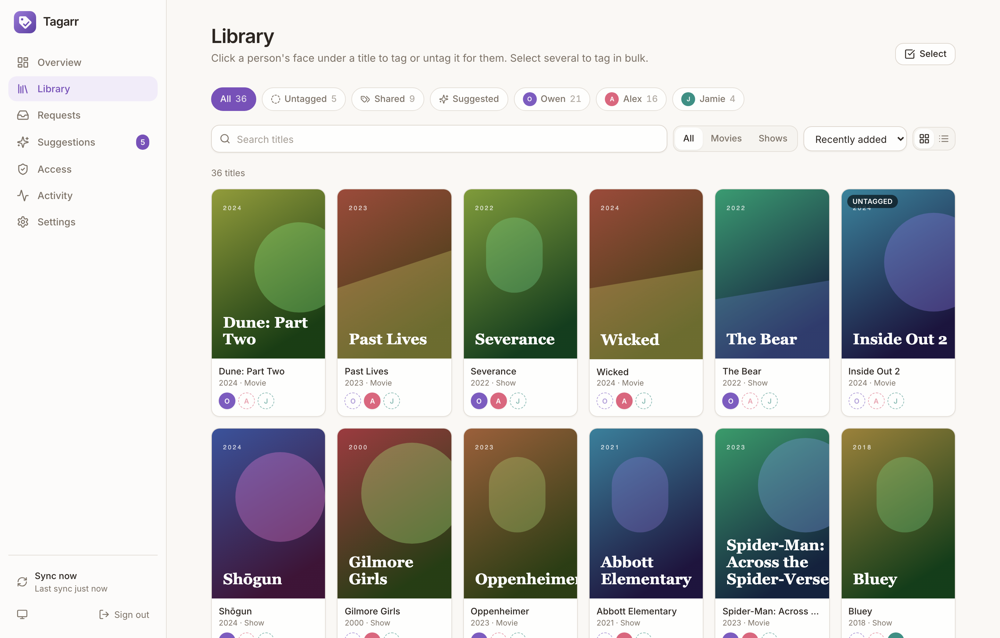
</picture>

</div>

## Why Tagarr

Jellyfin can limit a user to items with certain tags, which is the cleanest way to share one library between a couple or housemates without everyone's shows piling up on everyone's home screen. The catch is the tagging: it's manual, it's easy to forget, and an untagged show silently vanishes for everybody.

Tagarr does the tagging for you.

- **Requests tag themselves.** Request something in Seerr and it's tagged with your name the moment it lands in Jellyfin. Your partner's requests get theirs.
- **Shared is automatic.** If you both request a show, or you add yourself to one of theirs, it carries both tags and shows up for both of you.
- **Nothing gets lost.** Untagged titles are front and centre, watch history suggests who something belongs to, and an optional rule hands unrequested items to whoever you choose.
- **Tags stay put.** Tagarr keeps its own record and quietly puts back any tag a metadata refresh wipes.
- **One-click tagging.** Every poster has each person's face under it: click to add or remove. Select a whole row to tag in bulk.
- **Seasonal titles.** Halloween movies from Oct 1 to Nov 1, Christmas films in December: pick the titles and who gets them, and they appear and disappear on their own every year, with a Jellyfin collection that hides along with them.
- **Sets up the hiding too.** The Access page sets each Jellyfin user to only see their tag, without touching the rest of their profile.
- **On your dashboard.** A [Homepage](https://gethomepage.dev) widget shows what's untagged, shared and waiting at a glance.
- **Yours to run.** One small container, one volume, no accounts anywhere. Works on a Raspberry Pi.

<p align="center">
  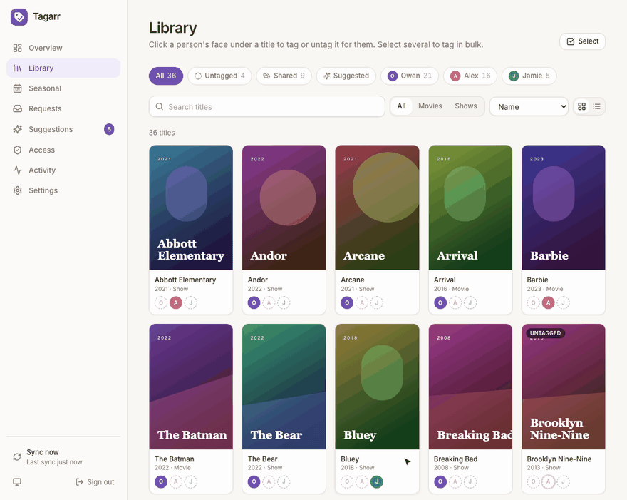
</p>

<table>
  <tr>
    <td width="50%">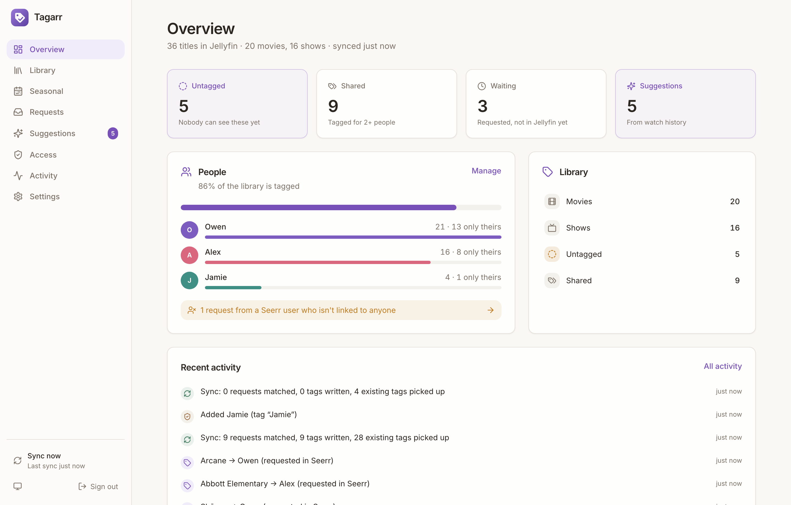</td>
    <td width="50%">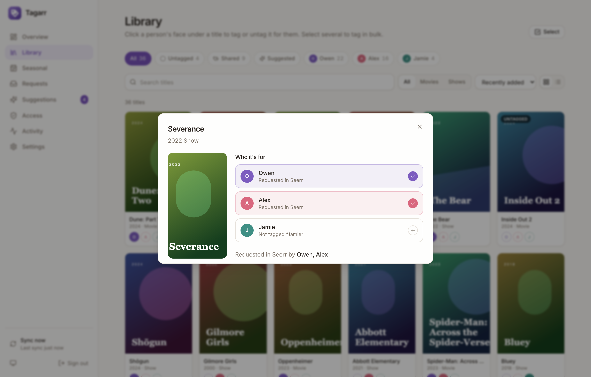</td>
  </tr>
  <tr>
    <td align="center"><sub>What's untagged, shared, waiting, and who has what</sub></td>
    <td align="center"><sub>Requested by both of you, so it's tagged for both</sub></td>
  </tr>
  <tr>
    <td width="50%">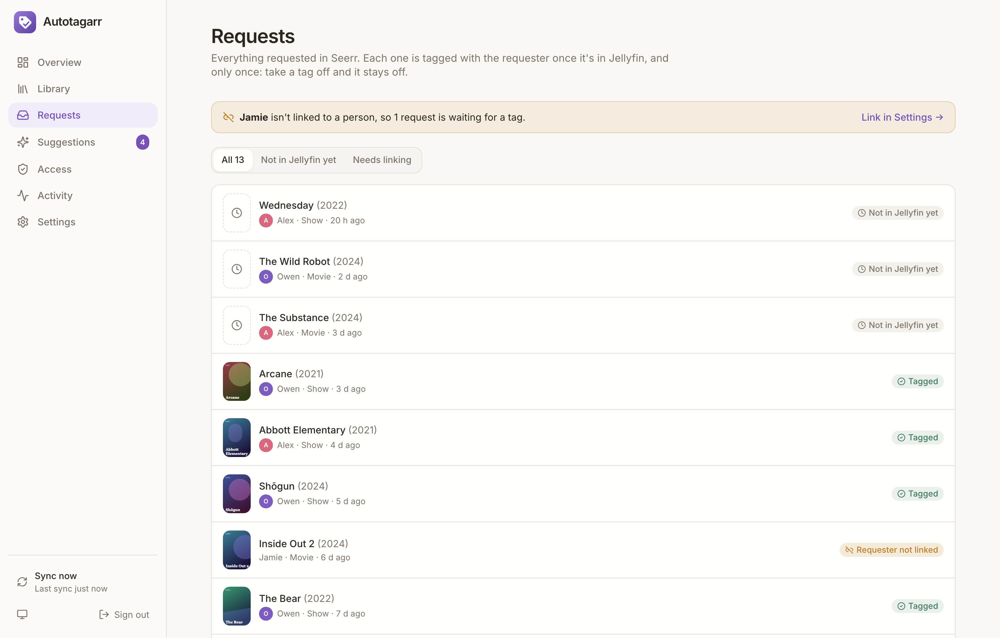</td>
    <td width="50%">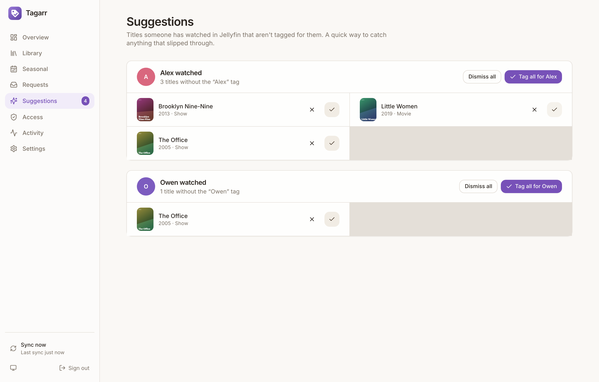</td>
  </tr>
  <tr>
    <td align="center"><sub>Every Seerr request and where it's at</sub></td>
    <td align="center"><sub>Watched it but not tagged? One click fixes it</sub></td>
  </tr>
  <tr>
    <td width="50%">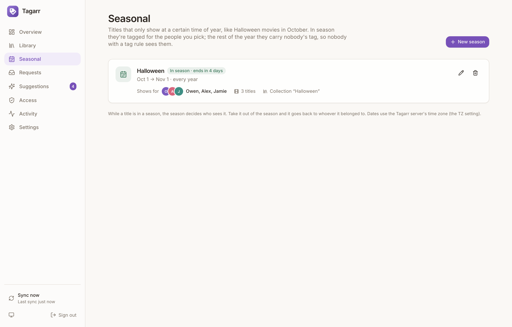</td>
    <td width="50%">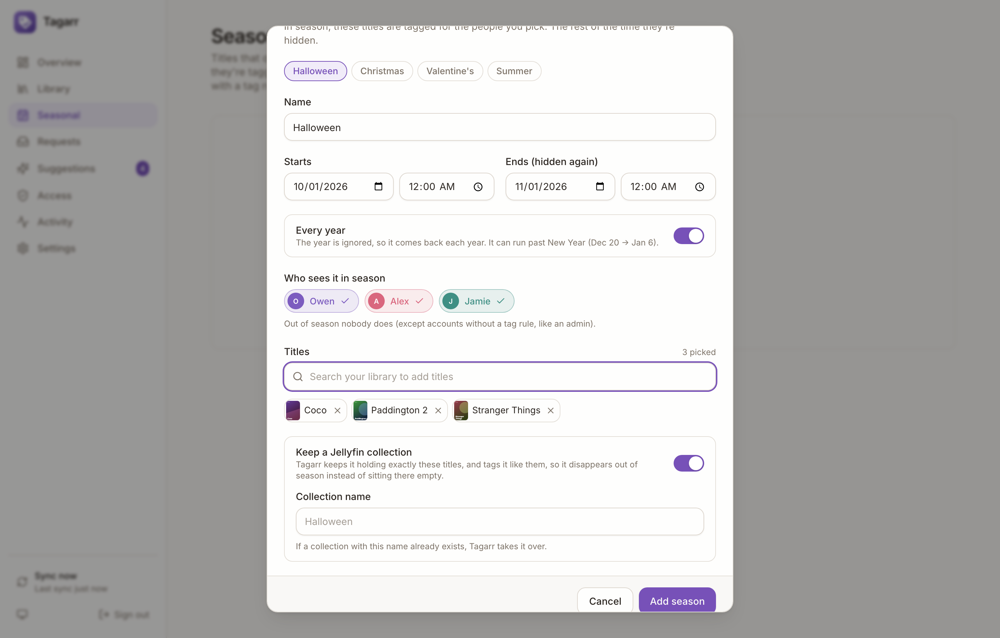</td>
  </tr>
  <tr>
    <td align="center"><sub>Halloween movies in October, gone in November</sub></td>
    <td align="center"><sub>Pick the dates, the people and the titles</sub></td>
  </tr>
  <tr>
    <td width="50%">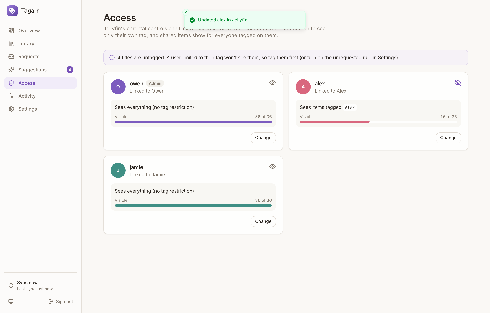</td>
    <td width="50%" align="center">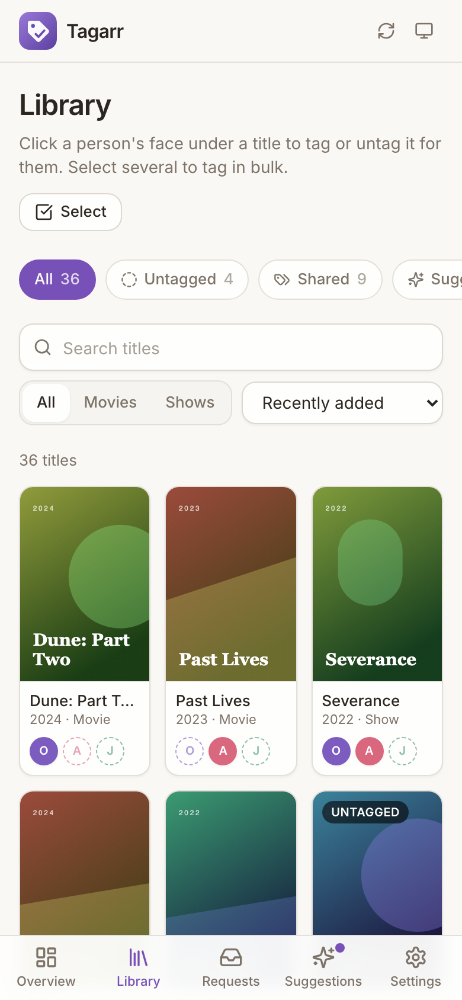</td>
  </tr>
  <tr>
    <td align="center"><sub>Who sees what, set straight from here</sub></td>
    <td align="center"><sub>Works on your phone, installable as an app</sub></td>
  </tr>
</table>

## Self-hosting

Tagarr is a single container with a single volume. It talks to Jellyfin and Seerr over their APIs; it doesn't need access to your media files. Images are published for `amd64` and `arm64`.

Works with **Jellyfin 10.9+** (10.8 works for tagging; see the [FAQ](#faq) for access rules) and **Seerr**, **Jellyseerr** or **Overseerr**.

### Quickstart

**1.** Save this as `docker-compose.yml`:

```yaml
services:
  tagarr:
    image: ghcr.io/owenwright8/tagarr:latest
    container_name: tagarr
    restart: unless-stopped
    environment:
      TZ: America/Indiana/Indianapolis   # optional, for log timestamps
    volumes:
      - tagarr-data:/data
    ports:
      - "8686:8686"

volumes:
  tagarr-data:
```

Already running Jellyfin and Seerr with Compose? Add the `tagarr` service to that file instead, and it can reach them by their service names.

**2.** Start it:

```sh
docker compose up -d
```

**3.** Open `http://<your-server-ip>:8686`, create your admin account, and follow the four-step setup:

| Step | What you need |
|---|---|
| **Jellyfin** | Its address (e.g. `http://jellyfin:8096` or `http://192.168.1.10:8096`) and an API key from **Dashboard → API Keys → +**. |
| **Seerr** | Its address and the API key from **Settings → General**. Optional, but it's what makes requests tag themselves. |
| **People** | Your Seerr users are listed with their Jellyfin accounts already matched: click **Add** on each. Already using tags? Pick the existing tag for each person and everything already tagged is picked up as it is. |
| **Finish** | Copy the webhook address it shows into Seerr (below), then **Finish and sync**. |

That's it. The first sync tags everything that's already been requested.

### Instant tagging with the Seerr webhook

Tagarr syncs every 15 minutes on its own. To have requests tagged the moment they're available:

1. In Seerr, go to **Settings → Notifications → Webhook** and turn it on.
2. Paste the **Webhook URL** from Tagarr's **Settings → Instant tagging** (it looks like `http://<tagarr>:8686/api/webhook/<secret>`). If Seerr reaches Tagarr by a different address, such as `http://tagarr:8686` on a shared Docker network, use that host with the same path.
3. Tick **Request Approved**, **Request Automatically Approved** and **Media Available**. Leave the JSON payload as it is.

The webhook doesn't carry any data Tagarr trusts. It just says "something changed", and Tagarr reads the details from Seerr and Jellyfin itself. The [Jellyfin Webhook plugin](https://github.com/jellyfin/jellyfin-plugin-webhook) can call the same address on **Item Added** too.

## How it works

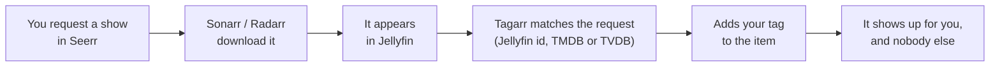

On every sync (every 15 minutes, on a webhook, or when you press **Sync now**), Tagarr:

1. **Reads the library** from Jellyfin: every movie and show, with their tags.
2. **Picks up existing tags.** If an item already has someone's tag, it's recorded as theirs. This is how an existing setup is adopted, and why adding a tag in Jellyfin's own editor sticks.
3. **Matches Seerr requests** to Jellyfin items and assigns each to its requester. Each request is applied **once**: if you take your tag off something you requested, it stays off.
4. **Applies the unrequested rule**, if you've turned it on.
5. **Collects suggestions** from linked users' watch history.
6. **Writes missing tags** to Jellyfin. This also repairs tags lost to a metadata refresh.

Removing someone from an item in Tagarr removes the tag in Jellyfin immediately. Only people's tags are ever touched: tags like `IMAX` or `4K` are left alone.

## Hiding each other's stuff

This is the part that makes a shared library feel like your own. Jellyfin's parental controls can restrict a user to **items with certain tags**. Combined with Tagarr:

| | Tagged | You see it? | They see it? |
|---|---|---|---|
| You requested it | `Owen` | ✅ | — |
| They requested it | `Alex` | — | ✅ |
| You both requested it, or you added yourself | `Owen`, `Alex` | ✅ | ✅ |
| Nobody requested it | *(none)* | — | — |

**Set it up on the Access page:** click **Change** on each Jellyfin user, choose **Only items tagged for…**, pick that person, and **Save to Jellyfin**. Tagarr only changes the user's allowed tags; the rest of their profile is left as it is. (You can also do this by hand in Jellyfin under **Dashboard → Users → *user* → Parental control → Allow items with tags**.)

Do this **after** the first sync has tagged things, and keep an eye on **Untagged** on the Overview: a user limited to their own tag can't see untagged items. If plenty of things get added outside Seerr, turn on **Items nobody requested** under **Settings → Automation** to hand them to chosen people automatically after a grace period.

> **Tip:** want some things to show for everyone, like kids' films? Add a person called "Everyone" with no Seerr or Jellyfin account, and include their tag in each user's allowed tags on the Access page. Tag anything with Everyone and it shows for all.

## Seasonal titles

The **Seasonal** page holds titles that should only show at a certain time, like Halloween movies in October. A season has:

- **Dates and times** it starts and ends, either **every year** (the year is ignored, and it can run past New Year, like Dec 20 → Jan 6) or **once**. Times are in the Tagarr server's time zone, so set `TZ`.
- **Who sees it** while it's in season.
- **The titles**: search for them in the season, or select them in the Library and choose **Add to season…**.
- **A Jellyfin collection**, if you want one. Tagarr makes it (or takes over one with the same name), keeps exactly the season's titles in it, and tags it the same way they're tagged.
- **A cover** for the collection, if you upload one (JPEG, PNG or WebP). Without one, Jellyfin draws a collage of the titles. If something in Jellyfin replaces the poster, Tagarr puts yours back.

Jellyfin looks collections up online by name, so a "Halloween" collection would otherwise turn into the *Halloween* film series, with its poster and description. Tagarr unlinks its collections from any online match and locks them (**Don't match it online**, on by default). Turn that off only if the season really is a film series' collection.

In season, each title is tagged for the season's people. Out of season it has nobody's tag, and so does the collection. A user limited to their own tags can't see an untagged item or an untagged collection, so the collection disappears instead of sitting there empty. Seasons switch on the minute, without waiting for the next sync, and the Activity page notes each start and end.

While a title is in a season, the season decides who sees it. Its usual people are kept, though: take it out of the season, or delete the season, and it goes back to whoever it belonged to before. Accounts with no tag rule, like an admin, always see everything.

## Homepage widget

Show Tagarr's numbers on a [Homepage](https://gethomepage.dev) dashboard with its built-in [Custom API widget](https://gethomepage.dev/widgets/services/customapi/).

1. In Tagarr, go to **Settings → Homepage widget** and **Create key**. The key is shown once, with a ready-to-paste snippet.
2. Add it to Homepage's `services.yaml`:

```yaml
- Tagarr:
    icon: http://<tagarr>:8686/icon-192.png
    href: http://<tagarr>:8686/
    description: Who sees what in Jellyfin
    widget:
      type: customapi
      url: http://<tagarr>:8686/api/widget
      refreshInterval: 300000
      headers:
        X-Api-Key: tgr_your_key_here
      mappings:
        - field: untagged
          label: Untagged
          format: number
        - field: shared
          label: Shared
          format: number
        - field: waiting
          label: Waiting
          format: number
        - field: suggestions
          label: Suggestions
          format: number
```

If Homepage runs on the same Docker network, use `http://tagarr:8686` for `url`.

<details>
<summary>Every field <code>/api/widget</code> returns</summary>

| Field | Format | What it is |
|---|---|---|
| `untagged` | number | Titles with nobody's tag (hidden from anyone with an access rule) |
| `shared` | number | Titles tagged for two or more people |
| `waiting` | number | Seerr requests not in Jellyfin yet |
| `suggestions` | number | Watch-history suggestions waiting for you |
| `unlinked_requests` | number | Requests from Seerr users not linked to a person |
| `total`, `movies`, `shows` | number | Library size |
| `tagged_pct` | percent | Share of the library that has an owner |
| `last_sync` | relativeDate | When the last sync finished |
| `last_sync_ok` | text | `true`, or `false` if it had problems |
| `people` | number | Per person, by tag: `field: { people: Owen }` |

</details>

The key can only read these numbers. Revoke it any time under **Settings → Homepage widget**; each key shows when it was last used.

## Settings

Everything is configured in the web UI. The compose file only takes these, all optional ([`.env.example`](.env.example) lists them):

| Setting | What it does |
|---|---|
| `APP_PORT` | The port published on the host when using this repo's `docker-compose.yml` (default `8686`). With the quickstart file, change the left-hand `8686` instead. |
| `TZ` | Time zone for log timestamps. |
| `UPDATE_CHECK` | `off` stops the server checking GitHub for new releases, and hides the update reminder (default `on`). |
| `TAGARR_VERSION` | Pin a release (`v1.0.0`) or a minor series (`1.0`, which still gets bug fixes) instead of `latest`. |

And in **Settings** in the app:

| Setting | Default | What it does |
|---|---|---|
| **Sync every** | 15 min | How often to read Jellyfin and Seerr. |
| **Items nobody requested** | Off | Give untagged, unrequested items to chosen people once they've been in Jellyfin for a grace period (default 24 h). Applied once per item. |
| **Suggestions from watch history** | On | List titles a linked Jellyfin user has watched but isn't tagged on. Nothing is tagged without you clicking. |
| **Tag seasons and episodes too** | Off | Copy each show's people tags onto its seasons and episodes. Jellyfin 10.9+ applies a show's tags to its episodes itself, so this is only for older servers, or if episodes of hidden shows still appear in *Continue Watching*. |
| **Libraries** | All | Limit Tagarr to some of your movie and show libraries. |

## Updating

When a new release is out, a slim **"Tagarr v1.1.0 is available — What's new"** note appears at the top of the app. To update:

```sh
docker compose pull && docker compose up -d
```

The database migrates itself. Read the [release notes](https://github.com/OwenWright8/tagarr/releases) first: anything you need to do will be at the top.

**Tagarr tells you.** When a new release is out, Tagarr shows it once with its release notes and how to update, then keeps a small **Update available** link in the sidebar. **Remind me later** asks again in a few days; **Skip this version** stays quiet until the next one. **Settings → About → Check for updates** checks straight away.

**How the check works.** Every 6 hours the container makes one anonymous request to GitHub's public API for the latest release. Nothing about your instance is sent, and browsers never contact GitHub themselves. `UPDATE_CHECK=off` stops it.

## Backups

Everything (settings, API keys, people, the tag record and the activity log) is one SQLite database in the `tagarr-data` volume. From the folder with your `docker-compose.yml`:

```sh
docker compose stop
docker run --rm -v "$(basename "$PWD")_tagarr-data":/data -v "$PWD":/backup alpine \
  tar czf "/backup/tagarr-$(date +%F).tar.gz" -C /data .
docker compose start
```

(Volume names are prefixed with the folder's name; `docker volume ls` shows yours.) Losing it isn't a disaster either: the tags themselves live in Jellyfin, and a fresh install adopts them on its first sync.

## Security notes

Found a security problem? Please report it privately; see [SECURITY.md](SECURITY.md).

- **The admin account is the only account.** It's separate from Jellyfin and Seerr, and sign-in attempts are rate limited per client address.
- **API keys stay on the server.** They're stored in the data volume and never sent to the browser. Treat the volume like a `.env` file.
- **Use HTTPS if it's reachable from outside your network.** The container speaks plain HTTP; put it behind your reverse proxy (Caddy, Traefik, nginx…) or keep it on your LAN / VPN. There's nothing to configure for a proxy.
- **Widget keys only read counts.** They're stored hashed, can't change anything, and can be revoked in Settings.
- **The webhook address contains a secret.** Anyone with it can trigger a sync (nothing more). You can rotate it under **Settings → Instant tagging**.
- **Hardened container.** It runs as an unprivileged user, and this repo's compose file also runs it with a read-only filesystem and `no-new-privileges`.

## FAQ

**I already tag things by hand. Will this mess them up?**<br/>
No. When you add a person, pick their existing tag (the box suggests the tags already in your library). The first sync records everything that already has it. Tags that aren't people's tags are never touched.

**What if a request comes from someone I haven't added?**<br/>
It waits. The Requests page and the Overview flag it, and as soon as you link that Seerr user to a person, all their past requests are tagged.

**I took my tag off something I requested. Will it come back?**<br/>
No. Each request is applied once. (If the item is deleted and downloaded again, it's treated as new and tagged again.)

**Does it work with Jellyfin 10.8?**<br/>
Tagging, yes. "Allow items with tags" only arrived in Jellyfin 10.9, so on 10.8 hide things with **Block items with tags** in Jellyfin instead (for example, block Alex's tag for Owen). Note that blocking hides shared items too, which is why 10.9+ is recommended. Turn on **Tag seasons and episodes too** on 10.8.

**Jellyseerr or Overseerr instead of Seerr?**<br/>
Both work: they share Seerr's API.

**Running it bound to a host folder instead of a named volume?**<br/>
Make the folder writable by uid 1000 (`sudo chown 1000:1000 ./data`), since the container doesn't run as root.

---

## Development

Needs Node 24 (the server is TypeScript that Node runs directly, using its built-in SQLite).

```sh
npm ci
npm run dev:mock   # fake Jellyfin on :8096 (key "jellyfin-key") and Seerr on :5055 (key "seerr-key")
npm run dev        # API on :8686, UI on http://localhost:5173
npm test           # server + sync engine end to end against the fakes
```

See [CONTRIBUTING.md](CONTRIBUTING.md) for how to report bugs and send changes.

`npm run build && npm run screenshots` walks through the setup wizard and every page in Chromium against the same fakes (run `npx playwright install chromium` once). With `SCREENSHOTS=1` it also regenerates `docs/screenshots/`.

### Releasing

Push a tag like `v1.0.0`. The release workflow creates the GitHub Release with notes grouped by PR label (`feature`, `fix`, `breaking`…; see `.github/release.yml`) and publishes the image as `:v1.0.0`, `:1.0` and `:latest` for amd64 and arm64. The notes also list every commit since the last release, which is what the in-app update prompt shows. Running instances notice within 6 hours.

## License

[MIT](LICENSE) © 2026 Owen Wright
